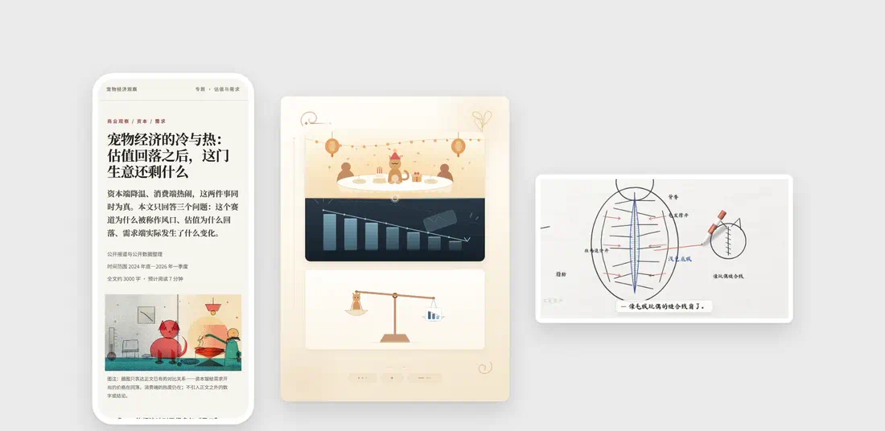
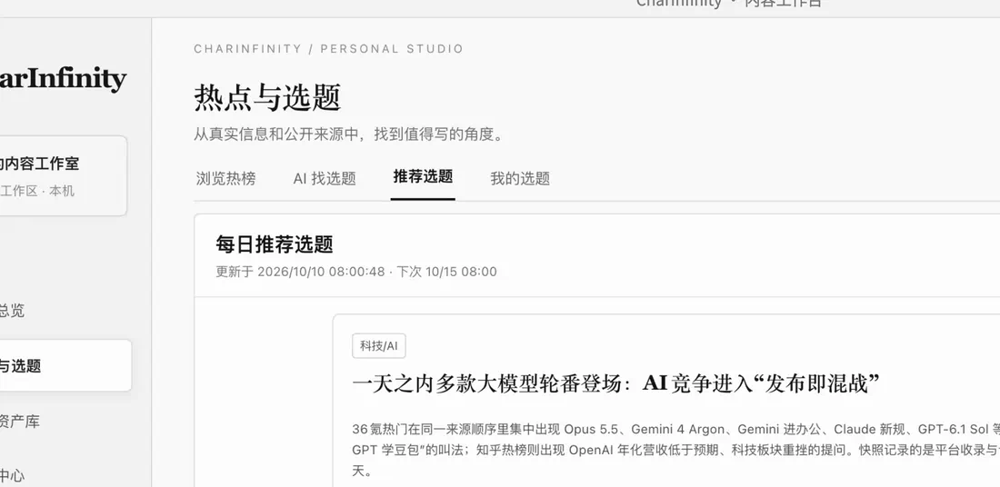
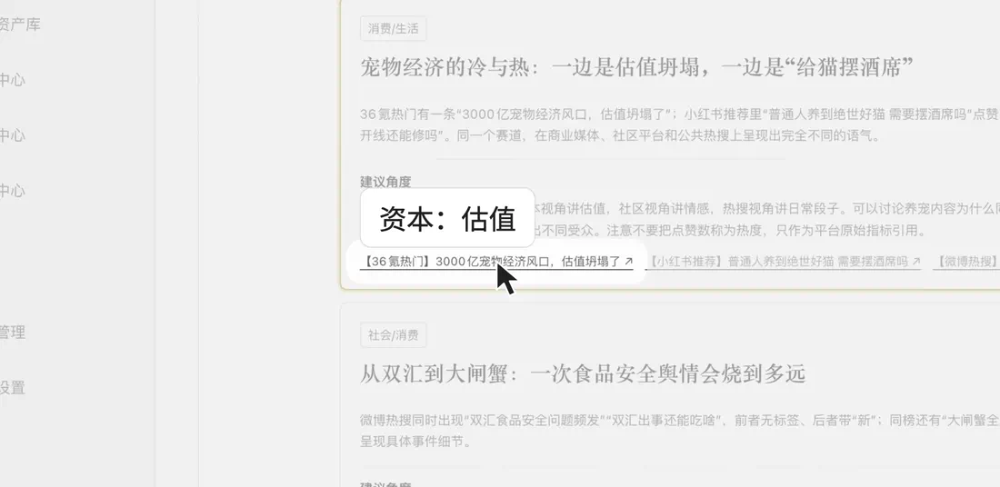
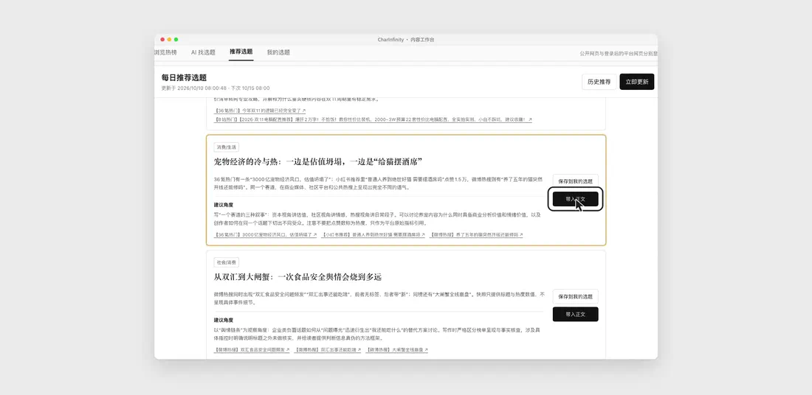
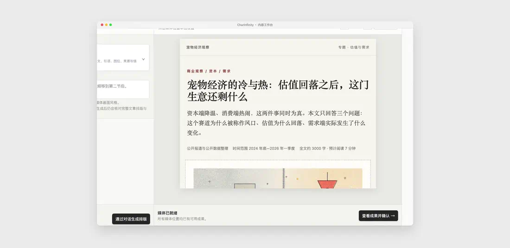
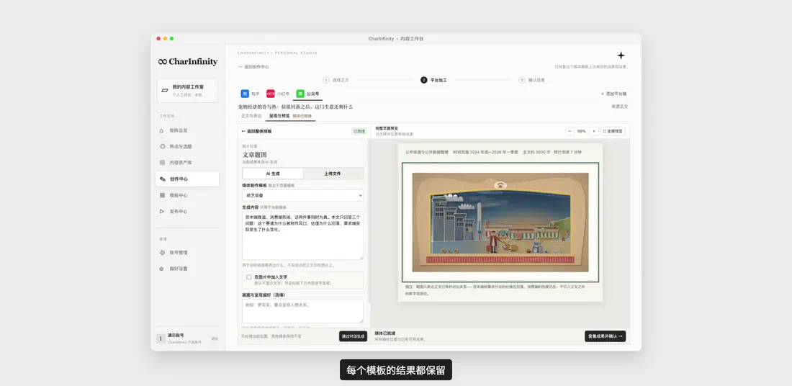
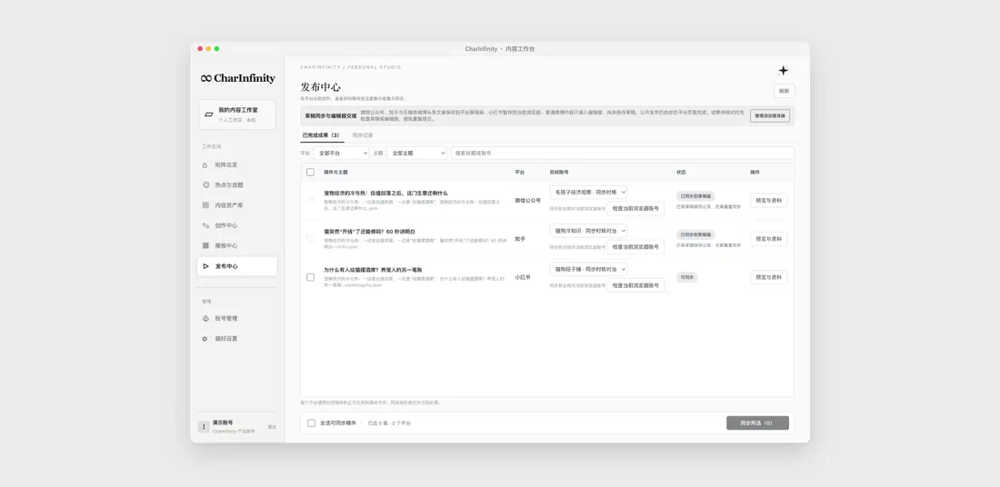
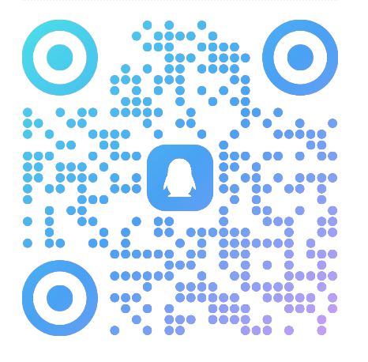

# ∞ CharInfinity

**为一个人运营多个内容账号而做的 AI 内容工作台**

从各平台热榜里发现选题，拆出不同角度，写成文章、做成图文和视频，再送进每个账号的草稿箱。

[下载安装包](../../releases/latest) · [开始使用](#开始使用) · [常见问题](#常见问题)

 

一个选题从热榜到草稿箱的全过程（20 秒）。活是 AI 做的，决定是你做的。

---

## 为什么做它

先说明一下：这是我自己做的工具。

我自己也在做号。每天最耗时间的不是写，而是写之前那些事：在好几个 App 之间刷选题、想这个热点从哪个角度写、同一份内容再按平台改一遍、排版、配图。通用的 AI 助手能帮上一部分，但它不是为"一个人管好几个号"这件事设计的界面，来回复制粘贴的活还是落在自己身上。

所以我把这些步骤放进了一个工作台。活交给 AI 做，选哪个题、用哪个角度、发不发，还是你自己决定。

## 一个选题，走完全程

下面是一个真实案例。10 月 10 日早上 8 点，CharInfinity 从微博、知乎、B站、36氪、小红书的榜单里整理出 10 个推荐选题，我们挑了其中一个——「宠物经济的冷与热」，看它在工作台里怎么一步步变成三份作品。

案例中的选题、正文、图文和视频由 CharInfinity 实际生成；账号与发布状态为演示。

### 01 · 发现选题：不用一早刷五个 App

每天早上，工作台把各平台榜单里值得跟进的内容整理成推荐选题，每一条都写明来源、推荐理由和可以切入的角度。点开原文就能核对。

### 02 · 拆出角度：一个选题，不只用一次

同一个话题，商业媒体讲估值，社区讲感情，热搜在玩梗。把它拆成三份平台稿，各自对准一群读者，分别推进，互不覆盖。

### 03 · 先写一份带出处的底稿

选好题后点「带入正文」，AI 先做深度调研。这个案例大约 4 分钟，写出一份 7800 多字的底稿，每个判断都附出处。AI 写东西最让人不放心的是数字，所以数字都标了来源，可以对照原文核对。底稿就是一份普通的 Markdown 文件，存在你自己电脑上。

### 04 · 排版和配图：选模板，预览里就是成品

正文、写作风格、图片、视频四类模板，选中就能套用。配图不满意，在旁边的助手里说一句，或者换个画风重画；换回原来的模板，之前的结果也还在。

### 05 · 做成视频：配音、字幕、画面都在后台做

同一个主题，也可以讲成一段带配音和字幕的视频。这段 53 秒的视频在后台做了大约 27 分钟，这段时间你可以去做别的。

### 06 · 发布准备：送进草稿箱，发布按钮留给你

账号按平台、赛道、账号三级管理，每个账号有自己的定位和读者。三份作品分给三个账号，送进各自的草稿箱；要不要公开发布，由你在平台后台决定。平台登录在应用自带的浏览器窗口里完成，每个账号一份独立的登录状态，登录信息不上传，也不交给 AI。

**这个案例的实际耗时**：深度调研正文约 4 分钟，三份平台文案各约 1 分钟，三份排版各 1–2 分钟。配图、卡片和视频在后台制作：单张配图 9–20 分钟，每页卡片 4–8 分钟，53 秒的视频约 27 分钟。

## 目前能做到哪一步

| | 现在的情况 |
|---|---|
| 选题来源 | 微博热搜、知乎热榜、B站热门、36氪热榜、小红书首页推荐；站内搜索；每天定时推荐，带来源和热度 |
| 平台稿 | 同一份正文，按平台和写作风格分别改写成独立的平台稿；不满意就在助手里说，改的始终是这一份 |
| 图文与视频 | 配图、知识卡片、带配音和字幕的讲解视频 |
| 草稿同步 | 微信公众号：存入后台草稿箱（图文、正文视频） 知乎：文章草稿 小红书：保存在应用自带浏览器里的本地草稿 |
| 不会做的事 | 不会自动公开发布；不做粉丝数、阅读量这类数据统计 |

抖音、视频号等平台还没有接入草稿同步。

## 开始使用

1. **下载安装**：到 [Releases](../../releases/latest) 下载对应系统的安装包（国内访问 GitHub 较慢时，也可以去[官网](https://charinfinity.baize-ailabs.com/)下载）。
2. **用手机号登录**。
3. **加入 QQ 群领取激活码**。参与内测的用户永久免费；激活一次，换电脑、重装都沿用。

   

4. **在偏好设置里填入模型服务的 API Key**，例如 DeepSeek。模型调用费用由你直接向模型服务商支付。
5. 第一次连接平台账号时，应用会打开自带的浏览器窗口，在里面登录你的平台账号即可，不需要安装浏览器扩展。

### 安装包说明

| 系统 | 安装包 | 说明 |
|---|---|---|
| macOS（Apple 芯片，macOS 13 及以上） | `charinfinity-0.1.11-mac-arm64.dmg` | 已签名并通过 Apple 公证，双击打开拖进「应用程序」即可 |
| Windows 10 / 11（x64） | `charinfinity-0.1.11-win-x64-unsigned-local.exe` | 没有代码签名。SmartScreen 提示「Windows 已保护你的电脑」时，点「更多信息」→「仍要运行」 |
| macOS（Intel 芯片） | — | 暂未提供 |

- 安装包约 0.5 GB，因为里面带好了平台浏览器、运行环境和音视频处理工具，你不用另外安装浏览器、Node、Python 或剪辑软件。
- 下载后可以用 Release 里的 `SHA256SUMS.txt` 核对文件是否完整：macOS 运行 `shasum -a 256 文件名`，Windows 运行 `certutil -hashfile 文件名 SHA256`。
- 应用内可以检查更新，有新版本时会主动提醒。

## 适合谁

**适合**

- 一个人运营两个以上的账号
- 同时做图文和视频
- 想把选题、写作、排版和发布准备放在一个地方

**暂时不适合**

- 只运营一个账号
- 主要拍真人口播短视频
- 主要在抖音、视频号等尚未接入草稿同步的平台发布

## 常见问题

<b>会自动替我发布吗？</b>

不会。工作台只把内容送进草稿箱，公开发布由你在平台后台确认。同步结果不明确时，会先提示你去后台核对，不会自动重复提交。

<b>我的内容存在哪里？</b>

正文和作品是你电脑上的普通文件，可以直接打开和备份。

<b>需要自己准备 AI 模型吗？</b>

需要。在偏好设置里填入模型服务（例如 DeepSeek）的 API Key 即可，模型调用费用由你直接向模型服务商支付。

<b>平台账号安全吗？</b>

平台登录在应用自带的浏览器窗口里完成，每个平台账号的登录状态彼此隔离。登录信息不会上传，也不会交给 AI。

<b>Mac 和 Windows 都能用吗？</b>

都能用。同一个账号最多可以在两台电脑上同时保持登录。

<b>为什么 Windows 提示"未知发布者"？</b>

Windows 安装包没有做代码签名，所以 SmartScreen 会拦一下。可以先用 `SHA256SUMS.txt` 核对摘要，确认文件和这里发布的一致，再点「更多信息」→「仍要运行」。Mac 安装包已签名并通过 Apple 公证，不会有这个提示。

<b>这个仓库里为什么没有源代码？</b>

CharInfinity 不是开源软件。这个仓库只用来发布安装包和产品介绍。

## 反馈与交流

- **应用内**：点「反馈问题」，写下当时在做什么、看到了什么。默认附带本机运行记录（只有操作类型、结果和时间，不含正文、文件路径、对话内容或登录凭据），我们逐条看。
- **QQ 群**：见上方[开始使用](#开始使用)里的二维码。
- **本仓库**：在 [Issues](../../issues) 提问题或建议。

---

© 2026 CharInfinity · <a href="https://charinfinity.baize-ailabs.com/">官网</a> · 本仓库仅发布安装包与产品介绍，不含源代码

